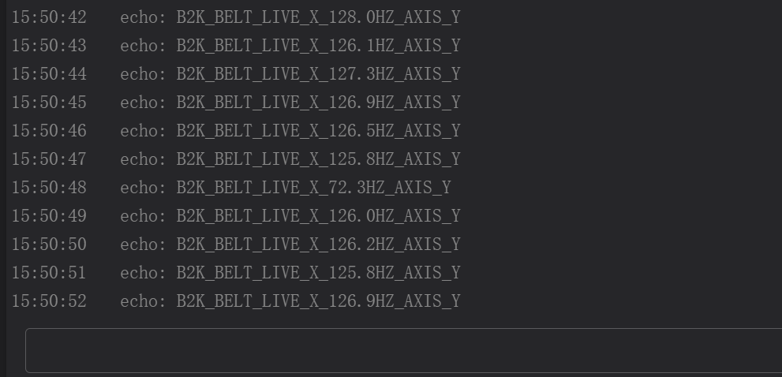
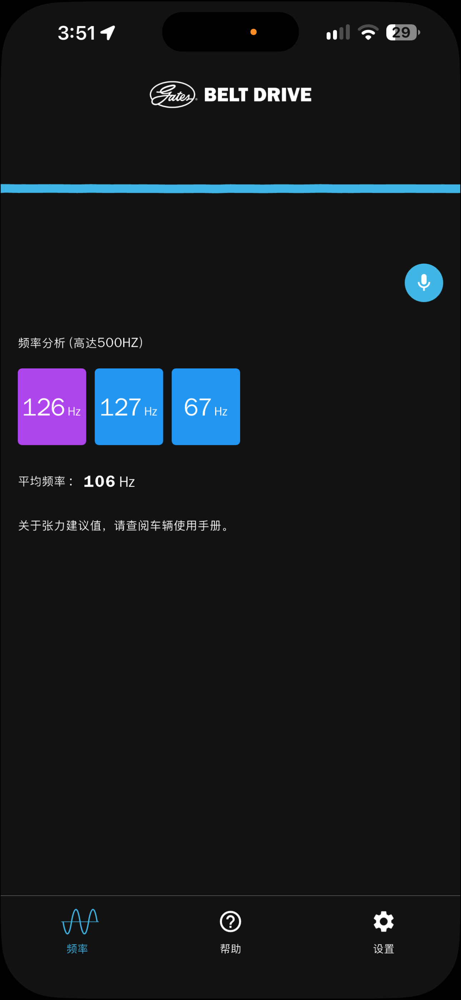

# B2K XY Calibration V0.1

Passive switch-event recording and manual belt-vibration frequency capture for Klipper CoreXY printers. The repository contains a Klipper extras module, explicit manual-merge configuration snippets, a configurable accelerometer stream collector, and sample profiles. The current hardware validation used a FLY modified Klipper fork; all other forks and sensor profiles need their API checked locally.

Chinese guides: [Usage tutorial](docs/使用教程.md) · [Configuration tutorial](docs/配置教程.md)

## Safety and scope

- Configure exactly one `[gcode_button]` for the single physical GPIO. `AXIS` and `DIRECTION` come from the experiment marker, never from the switch.
- The callback path records a coordinate sampled with Klipper's host-side `toolhead.get_position()`. CSV marks it `host_estimate`; it is not an MCU-latched trigger coordinate.
- Plugin commands do not move the toolhead. Use only a separately reviewed manual test plan with safe coordinates and clearances. Do not use `FORCE_MOVE`.
- Distances are metadata choices of 20, 50, or 100 mm. Without an independent length reference, the report is limited to repeatability and does not claim absolute motion scale error.
- No rotation distance, microsteps, acceleration, or other motion setting is changed.
- The GPIO is deliberately a placeholder. Do not copy a guessed pin number into a live printer configuration.
- The live manual-pluck collector runs on a host computer and sends rolling frequency readings to the Mainsail/Fluidd Console. It does not move the toolhead or alter printer motion settings. It reports a dominant acceleration peak, not calibrated belt tension.
- Sensor APIs are selected through editable JSON profiles. LIS2DW was used for printer validation; other supplied profiles are upstream API mappings and are not claimed as hardware-tested here.

## Files

- `klippy/extras/b2k_xy_calibration.py`: Klipper extras plugin, validation, event CSV, and analysis.
- `config/printer.cfg.xy-calibration-manual-merge.txt`: tool-setter plugin and one-GPIO button sections to merge into the existing `printer.cfg` after confirming the pin.
- `config/printer.cfg.belt-frequency-manual-merge.txt`: `BELT_X`, `BELT_Y`, and `OK` macro sections to merge into the existing `printer.cfg`.
- `config/accelerometers/*.json`: editable Klipper API profiles for LIS2DW, LIS3DH, ADXL345, MPU9250, and ICM20948.
- `tools/sensor_config.mjs`: profile validation and sample-field mapping.
- `tools/belt_session.mjs`: console-driven continuous capture; posts live peak frequency about once per second until `OK`.
- `tools/analyze_b2k_csv.py`: offline report command.
- `tools/belt_frequency.mjs`: subscribes to the selected accelerometer stream, computes a dominant vibration peak, saves the raw samples, and posts the result to the Fluidd console.
- `tests/test_b2k_xy_calibration.py`: simulated unit tests; these do not connect to a printer or move hardware.
- `LICENSE`, `NOTICE`, and `package.json`: Apache-2.0 project metadata; there are no third-party Node packages.

## Install on the printer host

1. Back up `printer.cfg` and confirm the running Klipper source path and version.
2. Copy `klippy/extras/b2k_xy_calibration.py` into the active Klipper tree's `klippy/extras/` directory. Use the same owner and permissions as neighboring extras.
3. Copy the required sections from the `config/printer.cfg.*.txt` manual-merge snippets directly into the existing `printer.cfg`; do not include the snippets or replace the full file. Replace `<BOARD_GPIO_PLACEHOLDER>` only after confirming the board pin assignment, electrical polarity, and whether a pull-up is required. Add only one `[gcode_button]` for this probe.
4. Restart Klipper through the installed service or the front end's Firmware Restart control. Inspect `klippy.log` for import/config errors before proceeding.
5. Verify the resting and manually actuated states with `QUERY_BUTTON BUTTON=b2k_probe`; do not begin a motion test until GPIO polarity and safe travel are independently confirmed.

## Marker commands (metadata only)

Start one experiment marker:

```gcode
B2K_CAL_START EXPERIMENT_ID=trident_x_001 TOOL_ID=T2 AXIS=X DIRECTION=POS DISTANCE=20 SPEED=20 ACCEL=300 TRIAL=1 START_POS=100 END_POS=120 TEMPERATURE=210
```

Valid distance values are 20, 50, or 100 mm. Enter speed in mm/s, acceleration in mm/s², temperature in °C, and trial as a positive integer. Positions and distance are in mm. These values plus tool, axis, direction, and experiment ID are recorded or validated. They describe the test; `B2K_CAL_START` does not command them.

The one button records each physical press/release automatically while a marker is active. To stop logging, issue:

```gcode
B2K_CAL_STOP
```

To produce JSON for the active CSV:

```gcode
B2K_CAL_REPORT
```

Or analyze later on any Python 3 host:

```powershell
python tools/analyze_b2k_csv.py path\to\b2k_xy_trident_x_001.csv
```

Run the local simulated Python tests (requires Python 3):

```powershell
python -m unittest discover -s tests -v
```

For an initial simulation, feed three synthetic `TRIGGERED` samples at 10.0, 10.2, and 9.8 mm plus their releases into a CSV. The report should show 3 trigger samples, 0.4 mm range, and scope `repeatability_only`. No printer or motion hardware is needed.

## Example CSV

```csv
experiment_id,timestamp_utc,monotonic_time,tool_id,axis,direction,commanded_distance,speed,accel,trial_id,commanded_start_position,commanded_end_position,trigger_position,capture_method,switch_state,temperature,quality_flags
trident_x_001,2026-11-20T12:00:00Z,123456.7,T2,X,POS,20.0,20.0,300.0,1,100.0,120.0,109.984,host_estimate,TRIGGERED,210.0,HOST_ESTIMATE;NO_INDEPENDENT_LENGTH_REFERENCE
```

## Example report

```json
{
  "title": "B2K XY Calibration V0.1 repeatability report",
  "claim_scope": "repeatability_only",
  "groups": [{
    "experiment_id": "trident_x_001", "tool_id": "T2", "axis": "X",
    "direction": "POS", "commanded_distance_mm": 20.0,
    "trigger_samples": 3, "speed": 20.0, "accel": 300.0,
    "commanded_start_position": 100.0, "temperature": 210.0,
    "mean_host_estimate_mm": 110.0, "range_mm": 0.4,
    "sample_stdev_mm": 0.2
  }],
  "limitations": [
    "Trigger positions are host_estimate values from the gcode_button callback path, not MCU-latched coordinates.",
    "Without an independent length reference, commanded distances cannot establish absolute scale error.",
    "This report summarizes repeatability only and does not modify printer motion parameters."
  ]
}
```

## Accelerometer profiles

The collector protocol is configurable so users can adapt it to a Klipper accelerometer object and API method. The supplied profiles cover Klipper's upstream stream endpoints:

| Profile | Klipper stream method | Sensor instance | Project validation |
| --- | --- | --- | --- |
| `lis2dw.json` | `lis2dw/dump_lis2dw` | `lis2dw` | Used on the FLY printer |
| `lis3dh.json` | `lis2dw/dump_lis2dw` | `lis3dh` | Upstream mapping only |
| `adxl345.json` | `adxl345/dump_adxl345` | `adxl345` | Upstream mapping only |
| `mpu9250.json` | `mpu9250/dump_mpu9250` | `mpu9250` | Upstream mapping only |
| `icm20948.json` | `icm20948/dump_icm20948` | `icm20948` | Upstream mapping only |

These profiles match the timestamped XYZ sample shape defined by upstream Klipper's sensor APIs. Forks may change method names or instance names. Copy `config/accelerometers/custom.example.json`, update the method, `params.sensor`, data path, and sample indices, then pass the file with `--sensor-config`. The collector expects samples convertible to time and three numeric axes; a different payload shape needs a small adapter change. See the upstream [Klipper API server](https://github.com/Klipper3d/klipper/blob/master/docs/API_Server.md), [LIS2DW/LIS3DH driver](https://github.com/Klipper3d/klipper/blob/master/klippy/extras/lis2dw.py), [ADXL345 driver](https://github.com/Klipper3d/klipper/blob/master/klippy/extras/adxl345.py), [MPU9250 driver](https://github.com/Klipper3d/klipper/blob/master/klippy/extras/mpu9250.py), and [ICM20948 driver](https://github.com/Klipper3d/klipper/blob/master/klippy/extras/icm20948.py).

## Manual belt-frequency capture

Run this from the project directory while the printer is ready and idle. You can measure the physical left and right belts in either order; the client records those labels separately and does not assume they map directly to Klipper X/Y axes. The client posts a live prompt to Fluidd Console; pluck that belt once when the prompt appears and let it ring. The capture ends automatically. Keep hands and tools clear of the toolhead and do not move the printer during capture.

```powershell
node tools/belt_frequency.mjs --host=YOUR_PRINTER_HOST --sensor-config=config/accelerometers/lis2dw.json --belt=LEFT --seconds=10
node tools/belt_frequency.mjs --host=YOUR_PRINTER_HOST --sensor-config=config/accelerometers/lis2dw.json --belt=RIGHT --seconds=10
```

The client reads the selected profile's Klipper stream over Moonraker's bridge WebSocket, calculates the strongest peak from 10–500 Hz, saves a raw CSV under `outputs/`, and sends an `M118` result to Fluidd's Console. The selected profile defines the Klipper method, sensor instance, and sample-column mapping. [Moonraker bridge WebSocket](https://moonraker.readthedocs.io/en/latest/external_api/introduction/#bridge-websocket), [Klipper API server](https://github.com/Klipper3d/klipper/blob/master/docs/API_Server.md).

The result is a measured vibration frequency only. It does not convert Hz to belt tension without the belt's linear mass density and vibrating free-span length, and it does not change motor or input-shaper settings. If the peak is weak or changes widely between repeated plucks, verify that the LIS2DW is rigidly mounted where it picks up belt vibration; the current printer mount location still needs confirmation.

## Test comparison screenshots

These screenshots document one manual X-belt pluck. Most Fluidd rolling peak readings shown are between 125.8 and 128.0 Hz, with one 72.3 Hz reading. The Gates Belt Drive app screenshot shows samples of 126, 127, and 67 Hz and an app-reported average of 106 Hz.

This is a field comparison between two tools, not a precision validation. Sensor mounting, window length, peak selection, and averaging may differ. The low reading is a reason to repeat the measurement and inspect background peaks. The screenshots do not establish equivalent algorithms or provide belt tension.

<table>
  <tr><th>Fluidd live output</th><th>Gates Belt Drive reference readings</th></tr>
  <tr>
    <td></td>
    <td></td>
  </tr>
</table>

## Console-driven X/Y belt capture

The config template now also defines three passive marker macros: `BELT_X`, `BELT_Y`, and `OK`. Merge their sections directly into the existing `printer.cfg` after checking for name conflicts; do not create an overriding config file. The collector runs on the computer that has this project, not inside Klipper:

```powershell
node tools/belt_session.mjs --host=YOUR_PRINTER_HOST --sensor-config=config/accelerometers/lis2dw.json
```

Keep that process running, then use the Mainsail/Fluidd Console:

1. Enter `BELT_X` for the physical belt labelled X, or `BELT_Y` for the physical belt labelled Y.
2. Pluck that belt once. The console receives a rolling frequency estimate about once per second while the capture runs.
3. Enter `OK` to stop and save the raw sensor samples as `outputs/belt_x_*.csv` or `outputs/belt_y_*.csv`. The final frequency is echoed to the console.
4. Run the other belt separately. Only one capture can run at a time.

The macros only emit marker responses; all accelerometer streaming, frequency analysis, and CSV writing happen in the local Node process. The macros do not home, move, or alter printer settings. If the local process is disconnected, the macros cannot start or stop a capture. Check existing macros before adding `OK`, since Klipper macro names are global. The live value is the strongest 10–500 Hz peak in the recent LIS2DW window; background peaks can dominate, so confirm a clear pluck response and repeat measurements before comparing belts. A displayed frequency is not a tension value.

This mode requires Node.js 22.4 or newer with built-in WebSocket support. Stop the local process with Ctrl+C. It does not require a Klipper restart after the macros have been merged and loaded, and it does not add any include/overlay file. The collector requires a host argument (`--host`) or the `B2K_PRINTER_HOST` environment variable; no printer address is embedded in the source.

Run the JavaScript simulation tests without installing dependencies:

```powershell
node --test
```

The equivalent package script is `npm test` when npm is installed.

The project is licensed under Apache-2.0. The supplied profiles are upstream API mappings; LIS2DW alone is marked as tested on the target printer. No motion or calibration setting is applied by these tools.

## V0.2 ideas

- Add integration checks against supported Klipper forks and sensor APIs; confirm GPIO pin syntax only for the target board before installing the switch template.
- Add optional serial/CSV quality summaries and explicit per-trial marker IDs, while keeping movement under operator control.
- For input-shaper advice, reuse Klipper's configured LIS2DW and its resonance calibration output, but require a reviewed `[resonance_tester]` point and operator-started test. Klipper `SHAPER_CALIBRATE` performs axis motion and can apply parameters live; it must not be triggered by the probe button or automatically applied by B2K.
- Validate repeated manual-pluck readings for the confirmed LIS2DW mount, then add optional target comparison only after the belt free-span length and belt mass are known.
- If precise trigger position is needed, add MCU-side timestamp/stepper-position capture supported by that firmware; do not relabel host estimates.
- Add independent calibrated length reference input before reporting absolute scale error.
