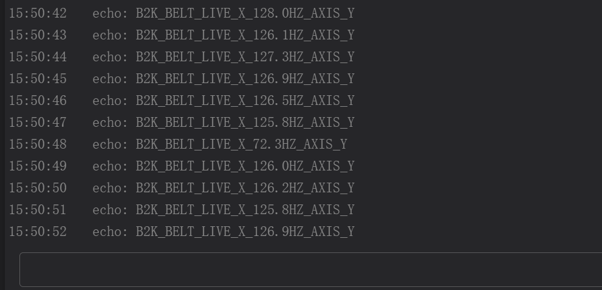
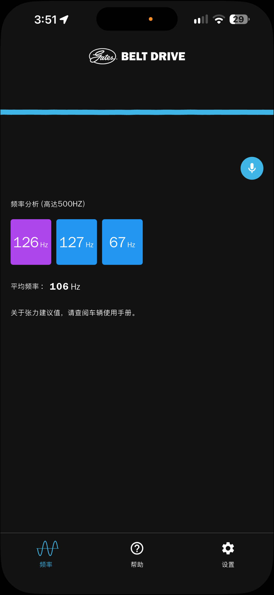

# B2K XY Calibration V0.1

面向 Klipper CoreXY 打印机的被动式 XY 皮带振动频率采集与单 GPIO 对刀仪事件记录工具。项目包含 Klipper extras 插件、需要手动合并进现有 `printer.cfg` 的配置片段、可编辑的加速度计数据流配置，以及本地实时采集程序。

[English README](README.en.md) · [Apache-2.0 License](LICENSE)

快速入口：[使用教程](docs/使用教程.md) · [配置教程](docs/配置教程.md)

## 功能

- 使用 Klipper 中已配置的加速度计读取三轴加速度采样。
- 控制台分别用 `BELT_X`、`BELT_Y` 启动测量，用 `OK` 停止；采集期间约每秒向 Mainsail/Fluidd Console 输出一次滚动主峰频率。
- 保存原始采样 CSV，记录最终频率、主响应轴、样本数和测量时长。
- 用单个 `gcode_button` 记录共享机械触发开关的按下/释放事件。
- 用实验标记记录 axis、direction、20/50/100 mm 测试距离、速度、加速度、trial、tool ID 等元数据。
- 对重复触发样本生成重复定位误差摘要；没有独立长度基准时不报告绝对运动比例误差。

频率值是加速度计检测到的振动主峰，不是皮带张力单位值。没有皮带自由跨距、线密度和边界条件等参数或独立张力基准时，不把频率换算成张力。

## 加速度计配置

采集器使用 Klipper 的加速度计数据流 API。传感器配置由 JSON profile 选择，可修改 Klipper API 方法、传感器实例名、样本字段路径和数组列索引。内置示例：

| Profile | Klipper API 方法 | 实例名 | 本项目验证情况 |
| --- | --- | --- | --- |
| `lis2dw.json` | `lis2dw/dump_lis2dw` | `lis2dw` | 在本机打印机使用过 |
| `lis3dh.json` | `lis2dw/dump_lis2dw` | `lis3dh` | 按 Klipper 上游接口映射，未做硬件测试 |
| `adxl345.json` | `adxl345/dump_adxl345` | `adxl345` | 按 Klipper 上游接口映射，未做硬件测试 |
| `mpu9250.json` | `mpu9250/dump_mpu9250` | `mpu9250` | 按 Klipper 上游接口映射，未做硬件测试 |
| `icm20948.json` | `icm20948/dump_icm20948` | `icm20948` | 按 Klipper 上游接口映射，未做硬件测试 |

Klipper fork 可能更改 API 名称或数据格式。使用前请核对实际 Klipper 版本和传感器对象名。[Klipper API 文档](https://github.com/Klipper3d/klipper/blob/master/docs/API_Server.md)、[LIS2DW/LIS3DH](https://github.com/Klipper3d/klipper/blob/master/klippy/extras/lis2dw.py)、[ADXL345](https://github.com/Klipper3d/klipper/blob/master/klippy/extras/adxl345.py)、[MPU9250](https://github.com/Klipper3d/klipper/blob/master/klippy/extras/mpu9250.py)、[ICM20948](https://github.com/Klipper3d/klipper/blob/master/klippy/extras/icm20948.py)。

自定义传感器时，复制 `config/accelerometers/custom.example.json` 到本地 JSON 文件，修改 `method`、`params.sensor`、`data_path`、`header_path` 和 `sample_columns`，然后用 `--sensor-config` 指定它。采集器期望数据为可映射到时间戳和 XYZ 三个数值轴的采样数组；完全不同的数据结构需要同时调整适配代码。

## 安装与使用皮带频率采集

需要 Node.js 22.4 或更新版本，不需要安装第三方 npm 依赖。先把 `config/printer.cfg.belt-frequency-manual-merge.txt` 中的三个宏**手动合并**到打印机现有的 `printer.cfg`。不要 include 该文本，也不要用它替换整份配置。若 `BELT_X`、`BELT_Y` 或 `OK` 已被使用，应先协调命名冲突。

在本项目目录运行采集器：

```powershell
node tools/belt_session.mjs --host=YOUR_PRINTER_HOST --sensor-config=config/accelerometers/lis2dw.json
```

也可以通过环境变量传入主机地址：

```powershell
$env:B2K_PRINTER_HOST = "printer.local"
node tools/belt_session.mjs --sensor-config=config/accelerometers/lis2dw.json
```

**测量位置：**每次弹拨皮带前，确认机器已回零、移动路径无障碍，再用 Mainsail/Fluidd 的手动移动控件将喷头移动到 **X=150、Y=150 mm**。X、Y 两条皮带都在这个位置测量。宏会在 Console 再次提醒，但不会自动移动打印机；若机器未回零或路径不安全，不要移动或开始测量。

保持这个进程运行，然后在 Mainsail/Fluidd Console 中：

1. 输入 `BELT_X` 或 `BELT_Y`，选择要测的皮带。
2. 手弹一次对应皮带；频率会滚动显示在控制台。
3. 输入 `OK` 结束并保存 CSV。
4. 再启动另一侧测量。一个采集器同一时间只接受一项测量。

默认 CSV 写入当前工作目录的 `outputs/`。宏只发开始和结束标记；采样、频谱计算和文件写入都由电脑上的 Node 采集器完成。此功能不移动机器，也不修改 `rotation_distance`、microsteps、加速度或 input-shaper 参数。

## 安装 Klipper 插件

在打印机主机的 SSH 终端执行。先确认 Klipper 源码目录；下面的 `$HOME/klipper` 只是常见位置，若实际路径不同，先替换成已确认的路径：

```sh
git clone --depth 1 https://github.com/ers-ye/klipper-xy-calibration.git "$HOME/klipper-xy-calibration"
export KLIPPER_DIR="$HOME/klipper"  # 改成已经确认的 Klipper 源码目录
test -d "$KLIPPER_DIR/klippy/extras" || { echo "Klipper extras 目录不存在；请核对 KLIPPER_DIR" >&2; exit 1; }
test ! -e "$KLIPPER_DIR/klippy/extras/b2k_xy_calibration.py" || { echo "插件文件已存在；停止以避免覆盖" >&2; exit 1; }
install -m 0644 "$HOME/klipper-xy-calibration/klippy/extras/b2k_xy_calibration.py" "$KLIPPER_DIR/klippy/extras/b2k_xy_calibration.py"
```

安装命令只复制一个 Klipper extras 插件文件；不会改写 `printer.cfg`、自动重启 Klipper 或执行任何运动。若插件文件已经存在，命令会停止，不覆盖现有文件。然后根据 `config/printer.cfg.xy-calibration-manual-merge.txt`，手动合并插件配置和唯一一个 `[gcode_button]` 到现有 `printer.cfg`。

将 `<BOARD_GPIO_PLACEHOLDER>` 替换为已核对的实际 GPIO 和电气极性设置。不要猜引脚。完成配置后，通过 Mainsail/Fluidd 执行 Firmware Restart，并检查 `klippy.log`；用 `QUERY_BUTTON BUTTON=b2k_probe` 确认开关状态。

按钮回调记录的是 `host_estimate`，不是 MCU 精确锁存坐标。插件本身不触发运动。不要用 `FORCE_MOVE` 进行正常校准，也不要在未确认安全坐标和碰撞路径前运行自动运动。

## 实验标记和分析

示例标记只记录元数据，不会执行所描述的运动：

```gcode
B2K_CAL_START EXPERIMENT_ID=trident_x_001 TOOL_ID=T2 AXIS=X DIRECTION=POS DISTANCE=20 SPEED=20 ACCEL=300 TRIAL=1 START_POS=100 END_POS=120 TEMPERATURE=210
```

停止标记并生成摘要：

```gcode
B2K_CAL_STOP
B2K_CAL_REPORT
```

皮带频率宏则使用 `BELT_X` 或 `BELT_Y` 开始一次实时采集，输入 `OK` 结束并保存 CSV；完整宏位于 `config/printer.cfg.belt-frequency-manual-merge.txt`，需要手动合并至原有 `printer.cfg`。操作步骤见[使用教程](docs/使用教程.md)。

离线 CSV 分析：

```powershell
python tools/analyze_b2k_csv.py path\to\b2k_xy_trident_x_001.csv
```

## 测试

JavaScript 模拟测试（不连接打印机、不执行运动）：

```powershell
node --test
```

Klipper 插件 Python 单元测试（需要 Python 3）：

```powershell
python -m unittest discover -s tests -v
```

## 项目文件

- `klippy/extras/b2k_xy_calibration.py`：Klipper 单开关事件记录插件。
- `tools/belt_session.mjs`：控制台宏驱动的实时皮带频率采集器。
- `tools/belt_frequency.mjs`：定时采集一次后返回主峰的命令行工具。
- `tools/sensor_config.mjs`：传感器 profile 校验和样本映射。
- `tools/analyze_b2k_csv.py`：离线重复定位误差分析。
- `config/printer.cfg.*.txt`：需手动合并的配置片段，不是 include 文件。
- `config/accelerometers/`：内置和自定义加速度计数据流配置。

## 许可证

项目使用 [Apache-2.0](LICENSE)，包含该许可证的专利授权条款。

## 实测对照截图

以下截图记录了一次现场手弹 X 侧皮带的读数。Fluidd 控制台的滚动窗口中，大多数主峰读数位于 125.8–128.0 Hz，另有一次 72.3 Hz；Gates Belt Drive 应用截图显示 126、127、67 Hz，应用给出的平均值为 106 Hz。

这只是两个工具在一次测试中的读数对照。传感器安装位置、窗口长度、峰值选择和平均方法可能不同；低频样本也说明应重复测量并检查背景峰。图片不能证明测量精度等同，也不能单独给出皮带张力。

<table>
  <tr><th>Fluidd 实时输出</th><th>Gates Belt Drive 参考读数</th></tr>
  <tr>
    <td></td>
    <td></td>
  </tr>
</table>
